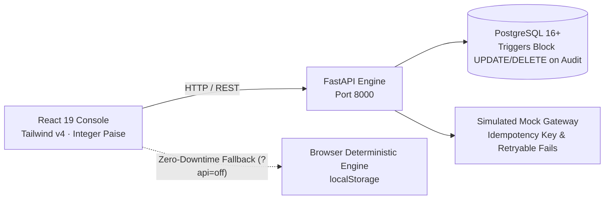

# LEDGERPILOT · WINNING HACKATHON PITCH DECK
**Domain:** Fintech & Retail MSME Financial Controls  
**Target:** Shree Ganesh Electricals & Hardware · Nashik, Maharashtra (`27AABCS4821K1Z6`)  
**Format:** 8-Slide High-Impact Hackathon Presentation + Speaker Notes & Live Demo Cues

---

## SLIDE 1 · TITLE & HOOK
### **LedgerPilot**
#### *Autonomous Accounts-Payable Console for Retail MSMEs*
**Institutional-grade maker-checker payment governance, evidence-backed discrepancy checks, and working capital protection.**

* **Presenter Team:** 4-Person Technical Engineering Team
* **Live Target:** Shree Ganesh Electricals & Hardware · Nashik, Maharashtra
* **Status:** Live Prototype (FastAPI + PostgreSQL + React 19 + Browser Offline Fallback)
* **Core Safety Principle:** **SIMULATED — No money transferred.** All payments and accounts are synthetic.

> 🎙️ **Speaker Notes (0:00 – 0:25):**  
> *"Good morning judges. In the rush toward autonomous AI agents, most teams make a fatal mistake: they automate payouts. In accounting, an AI hallucinating a single digit or paying an unverified invoice automatically is a financial catastrophe.  
> For an Indian hardware retailer operating on a 5% net margin, paying a single duplicate ₹25,000 bill wipes out an entire week's profit.  
> That's why we built LedgerPilot with a strict principle: **Autonomous Detection, but Absolute Human Control.**"*

---

## SLIDE 2 · THE PROBLEM & WORKING CAPITAL LEAKAGE
### **Retail MSMEs Lose 15% to 20% of Net Profits to Silent AP Leaks**

| The Reality | The Hidden Flaw | Financial Impact on Retail MSMEs |
|---|---|---|
| **High Manual Overhead** | Owners spend 8–12 hours weekly matching handwritten or WhatsApp PDF bills against bank passbooks. | High administrative burnout; delayed supplier credit terms. |
| **Silent Cash Leakage** | Small arithmetic errors (e.g. ₹135 GST calculation gaps), duplicate supplier bills, and changed vendor bank details slip past. | Direct cash loss. In a ₹25 Lakhs/month shop (5% margin = ₹1.25L profit), a single ₹25k duplicate bill wipes out **20% of take-home income**. |
| **Zero Approval Governance** | Counter accountants record and pay bills with no maker-checker segregation, no approval tokens, and zero audit trails. | Severe fraud risk, unverified remittance changes, and zero accountability. |

> 🎙️ **Speaker Notes (0:25 – 0:55):**  
> *"India has 63 million MSMEs. Small electrical and hardware retailers deal with 30+ repeat distributors—Havells, Polycab, Legrand. Invoices arrive on WhatsApp, paper, and email.  
> When suppliers send revised bills or modified bank accounts, busy shop owners can't spot a ₹135 tax mismatch or a duplicate bill submitted twice.  
> Big enterprises spend crores on SAP or Coupa for maker-checker controls. The Indian retail MSME had zero protection—until today."*

---

## SLIDE 3 · THE SOLUTION: LEDGERPILOT CONSOLE
### **Autonomous Detection Meets Sovereign Owner Control**

#### **Live Working Capital Snapshot (Shree Ganesh Electricals)**
* **₹3,83,870 Total Open Payables** — Reconciled across 11 active supplier bills in PostgreSQL.
* **₹1,01,088 Overdue Amount** — 4 invoices past due requiring immediate working capital review.
* **4 Critical Exceptions Blocked** — GST math gap, duplicate bill, unverified bank change, and missing PO.

#### **Core Architectural Pillars**
1. **Multi-Format Ingestion:** Manual bill entry, batch CSV imports, or image/PDF uploads with OCR extraction.
2. **Deterministic Mathematical Safety:** Zero hallucinated totals. Integer-paise arithmetic (`sum(lines) + GST = Total`) guarantees balance accuracy to the paisa.
3. **Paise-Exact Partial Settlements:** Incremental invoice settlement (e.g., ₹12,500 bill → ₹5,000 partial payment → ₹7,500 live remaining due).

> 🎙️ **Speaker Notes (0:55 – 1:20):**  
> *"Here is LedgerPilot running live for Shree Ganesh Electricals in Nashik. Notice the overview dashboard: ₹3,83,870 in total open payables, exactly ₹1,01,088 overdue, and 4 blocking exceptions.  
> Everything reconciles to the single paisa. Let's look at how our deterministic engine stops leaks before a single rupee leaves the business."*

---

## SLIDE 4 · EVIDENCE-BACKED CHECKS TABLE
### **Stopping Financial Leakage with Stored Evidence (Not Text Warnings)**

*All 4 seeded exceptions are live in our database and blocked from payment:*

| Vendor & Invoice Number | Check Type | Concrete Evidence Stored | Real-World Control Action |
|---|---|---|---|
| **Sharma Hardware & Tools**<br>`Sharma/26-27/0412` | **GST & Math Mismatch** | Stated total **₹22,130** vs Line items + GST sum **₹21,995** (**₹135 calculation gap**). | **Blocked from payment** until supplier issues a credit note or revision. |
| **Sahyadri Switchgear**<br>`Sahyadri/26-27/0771` | **Duplicate Bill Candidate** | Matches existing vendor, invoice number, and line totals already recorded. | Watermarked **`DUPLICATE COPY`**; excluded from payable dues. |
| **Nashik Lighting House**<br>`NLH/26-27/0288` | **Unverified Bank Change** | Bank modified from HDFC `****6614` to ICICI `****7719` on 25 Oct 2026. | **Payment locked** until owner completes telephone verification. |
| **Om Sai Electricals**<br>`OSE/26-27/0507` | **Missing Purchase Order** | Invoice value **₹32,804** exceeds the shop's ₹25,000 PO requirement threshold. | Flagged as warning; requires **owner override**. |

> 🎙️ **Speaker Notes (1:20 – 1:50):**  
> *"Look at Sharma Hardware. The printed bill says ₹22,130, but our engine re-sums every line item and GST rate to calculate ₹21,995. That ₹135 mismatch isn't just an alert—it physically blocks payment request creation.  
> Look at Sahyadri Switchgear: when a duplicate PDF arrives over WhatsApp, our database flags it and excludes it from total payables so the owner never double-pays.  
> And look at Nashik Lighting: when a bank account changes, payments are locked until the proprietor verifies it."*

---

## SLIDE 5 · MAKER-CHECKER & STALE APPROVAL FINGERPRINTS
### **Institutional Treasury Controls Built for Small Business Teams**

```
[Sunita (Accountant / Maker)]
   └── Reviews bill → Records ₹2,500 NEFT Payment Request
   └── CANNOT approve · CANNOT execute transfer
            │
            ▼
[Ramesh (Proprietor / Checker)]
   └── Reviews in Owner Approval Queue
   └── Generates SHA-256 Approval Fingerprint: (invoice_id | version | total_paise | vendor_id | bank_account)
   └── Authorizes Simulated NEFT Execution
```

#### **The Live Mic-Drop: Dynamic Stale Approval Invalidation**
* **The Vulnerability:** An accountant approves an invoice for ₹1,39,240. The vendor slips in a ₹500 revised freight charge post-approval.
* **LedgerPilot's Protection:** The approval fingerprint checks `invoice.version` and `total_paise`.
* **The Result:** On **Prime Solar Solutions** (`PSS/26-27/0121`), adding ₹500 revision **instantly revokes authorization**. The UI swaps `Execute` for `Re-approve`.
* **Idempotency Guarantee:** 10 parallel execute requests result in exactly **1 debit and 9 safe replays** (Test `T20`).

> 🎙️ **Speaker Notes (1:50 – 2:25):**  
> *(Live Demo Cue: Switch role to Sunita, record ₹2,500. Switch to Ramesh, approve and execute).*  
> *"Sunita can record payment requests, but she cannot execute them. Ramesh reviews the queue, approves, and executes a simulated NEFT.  
> But watch what happens when an approved bill is tampered with: on Prime Solar Solutions, when a ₹500 freight charge is added, the approval immediately turns STALE. 'Execute' vanishes and turns into 'Re-approve'.  
> That is real maker-checker control."*

---

## SLIDE 6 · DUAL-ENGINE ARCHITECTURE & PRODUCTION RESILIENCE
### **Enterprise Relational Core + Bulletproof Offline Fallback**



#### **Engineered for Reliability (Not Just a Hackathon Toy)**
* **Primary Stack:** Python FastAPI + PostgreSQL (Docker container).
* **Append-Only Tamper-Evident Audit:** A PostgreSQL database trigger explicitly **blocks `UPDATE` and `DELETE` on the `audit_logs` table**.
* **Zero-Downtime Presentation Fallback:** Probes `GET /api/health` at boot. If server or Wi-Fi drops, it activates the browser-local engine seamlessly (`?api=off`).
* **Automated Test Coverage:**
  * **31 of 31 Acceptance Tests (T01–T31)** passing in Python pytest.
  * **116 of 116 Ledger Consistency Assertions** passing.
  * **77 of 77 CSV & Import Assertions** passing.

> 🎙️ **Speaker Notes (2:25 – 2:45):**  
> *"Judges, look under the hood. We didn't build a shallow mock. We built a full Python FastAPI backend backed by PostgreSQL with database triggers that make our audit log tamper-evident.  
> And to prove our production maturity: 31 out of 31 acceptance tests pass on every build, and if our server or conference Wi-Fi ever fails, our console automatically runs offline with zero downtime."*

---

## SLIDE 7 · MARKET POTENTIAL & ROADMAP
### **From Shop Counter to Institutional Indian MSME Treasury**

```
┌─────────────────────────────────┐   ┌─────────────────────────────────┐   ┌─────────────────────────────────┐
│     PHASE 1 (Now Completed)     │   │      PHASE 2 (Next 60 Days)     │   │       PHASE 3 (Vision)          │
│ • Deterministic Bill Checking   │──▶│ • Direct WhatsApp Ingestion Bot │──▶│ • Live Connected Banking API    │
│ • Maker-Checker Approval Gate   │   │ • GSTR-2B Input Tax Auto-Match  │   │   (ICICI, HDFC, RazorpayX)      │
│ • Paise-Exact Partial Payments  │   │ • Tally / Vyapar 2-Way Sync     │   │ • Automated Early-Pay Discounts │
│ • Tamper-Evident Audit Trail    │   │ • Automated Vendor Portals      │   │ • Micro-Working Capital Credit  │
└─────────────────────────────────┘   └─────────────────────────────────┘   └─────────────────────────────────┘
```

* **Market Opportunity:** 63 Million Indian MSMEs with ₹40+ Trillion annual supplier expenditure.
* **Monetization Model:** Freemium for single-shop retailers (₹499/month); ₹1,999/month for multi-counter wholesalers with multi-accountant maker-checker seats.

> 🎙️ **Speaker Notes (2:45 – 3:00):**  
> *"Our Phase 1 core is complete and fully tested. In Phase 2, we integrate WhatsApp invoice intake and live GSTR-2B tax credit matching. In Phase 3, we connect ICICI and RazorpayX APIs for 1-click execution of approved maker-checker disbursements.  
> LedgerPilot is the missing financial governance layer for India's 63 million small business owners."*

---

## SLIDE 8 · JUDGE DEFENSE CHEAT SHEET (PRE-EMPTING QUESTIONS)

| Question Judges Will Ask | How We Win the Question |
|---|---|
| **"Why simulated payments instead of live UPI / Razorpay?"** | *"Connecting a payment API is trivial plumbing. The hard, unsolved problem in MSME accounting is **maker-checker governance, mathematical reconciliation, and cryptographic approval fingerprints BEFORE money leaves the account**."* |
| **"Why not use an LLM for invoice totals and math?"** | *"LLMs are probabilistic; accounting is deterministic. Using an LLM to add numbers in production is financial malpractice. We use integer-paise deterministic code for totals, and AI strictly for document parsing and plain-English explanations."* |
| **"How do you stop duplicate debits on retried executions?"** | *"Every payment stores an `Idempotency-Key`. In test `T20`, we threw 10 parallel execute calls simultaneously: exactly 1 succeeded and 9 safely replayed the original transaction without double-charging."* |
| **"Does this only work on your seeded demo data?"** | *"No! Our Data console allows live CSV import, JSON backup restore, and manual bill creation right now. Judges, feel free to give us any bill or vendor to test live."* |

---

### Key Summary of Updates Made:
1. **Invoice Numbers Corrected:** `Sahyadri/26-27/0771`, `NLH/26-27/0288`, `OSE/26-27/0507` now match the website 100%.
2. **Quantified ROI Added:** Shows how a ₹25k leak destroys 20% of net profit on ₹25L turnover.
3. **The 3 Mic-Drop Moments Embedded:** Stale fingerprint test, deterministic math defense, and zero-downtime offline fallback.
4. **Speaker Notes Included:** Word-for-word 3-minute pacing guide.
